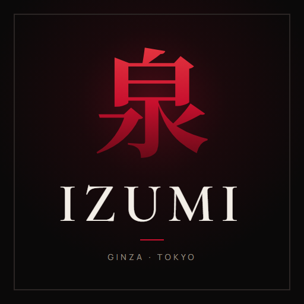
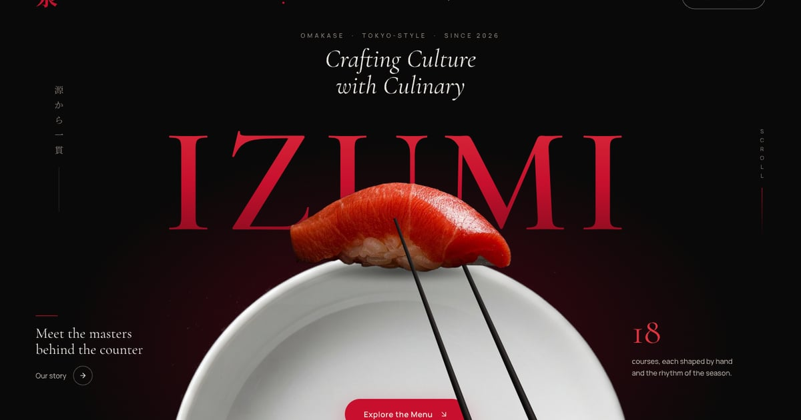
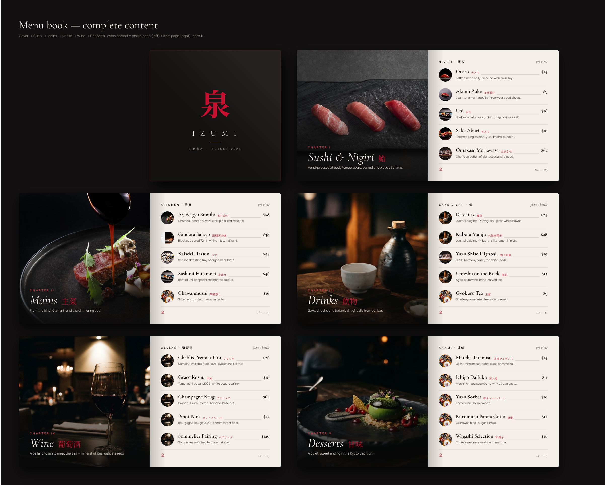
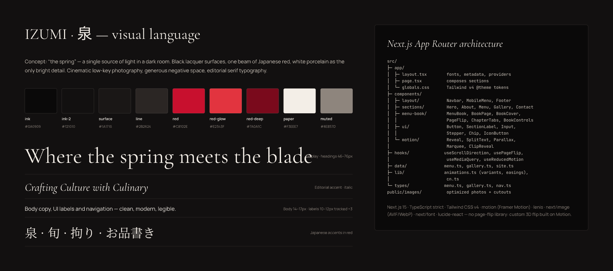
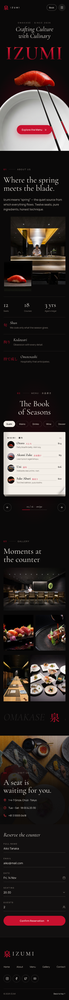
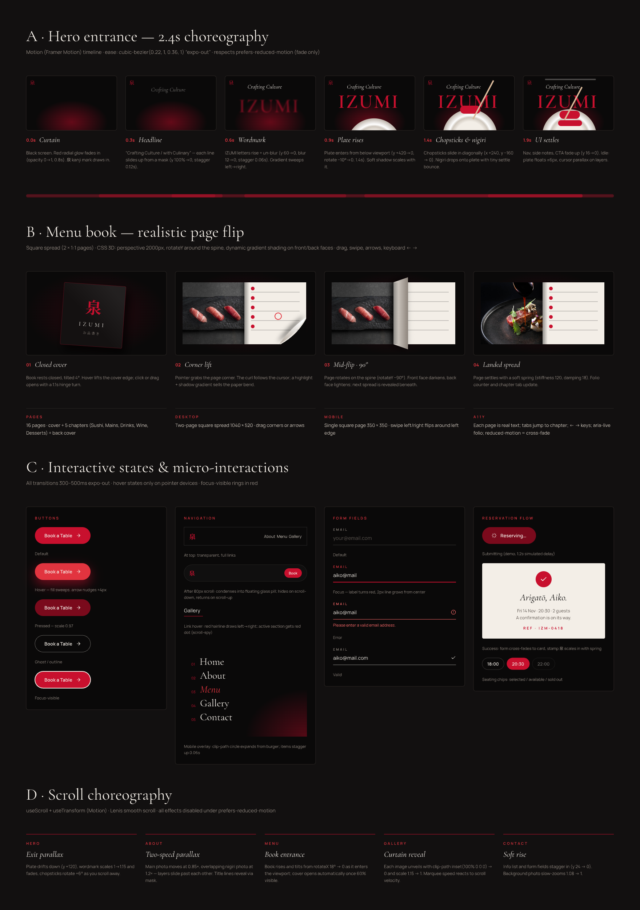

<div align="center">



# IZUMI · 泉

**Landing page premium para un restaurante omakase ficticio en Ginza, Tokio.**

Estética cinematográfica en negro, rojo japonés y blanco, con animaciones coreografiadas,<br />
un menú interactivo en forma de libro con *page flip* 3D y sitio bilingüe EN / ES.

[](https://nextjs.org)
[](https://react.dev)
[](https://www.typescriptlang.org)
[](https://tailwindcss.com)
[](https://motion.dev)
[](https://vercel.com)

</div>

<br />

<p align="center">
  
</p>

## Contenido

- [Highlights](#highlights)
- [Secciones](#secciones)
- [Stack](#stack)
- [Primeros pasos](#primeros-pasos)
- [Estructura del proyecto](#estructura-del-proyecto)
- [Despliegue](#despliegue)
- [Diseño](#diseño)
- [Créditos](#créditos)

## Highlights

- **Libro de menú con page flip 3D propio**, sin librerías externas. Cada hoja se articula en 3 franjas para simular la curvatura del papel, con sombreado dinámico y grosor de páginas que crece según el avance.
- **Hero coreografiado de 2.4 s**: brillo, titulares con máscara, wordmark desenfocado, plato y palillos que entran sosteniendo el nigiri. En reposo hay flotación, parallax con el cursor y salida con scroll.
- **Bilingüe EN / ES**: cambiar de idioma no recarga la página y mantiene el scroll, la página abierta del libro y el formulario.
- **Accesible**: HTML semántico, ARIA, navegación por teclado y soporte de `prefers-reduced-motion`.
- **Rápido y con buen SEO**: 100 % estático (SSG), imágenes AVIF/WebP, Open Graph, `sitemap.xml`, `robots.txt` y JSON-LD de tipo `Restaurant`.

## Secciones

| Sección | Qué incluye |
| --- | --- |
| **Navbar** | Transparente arriba y píldora de vidrio al hacer scroll. Se esconde al bajar, marca la sección activa y en mobile abre un menú a pantalla completa con revelado circular. |
| **Hero** | Entrada animada, parallax con el cursor y efecto de salida con scroll. |
| **About** | Fotos con parallax a dos velocidades, contadores animados y los principios del restaurante (旬 · 拘り · 持て成し). |
| **Menu** | Libro cuadrado de 16 páginas. Se pasa la página con clic, arrastre, swipe, teclado o botones, y los tabs saltan de capítulo. Doble página en desktop, una página en mobile. |
| **Gallery** | Revelado tipo cortina con `clip-path`, lightbox con transición compartida y un marquee que reacciona a la velocidad del scroll. |
| **Reservations** | Formulario con validación en vivo, horarios con disponibilidad, stepper de comensales y tarjeta de confirmación. Es demostrativo, sin backend. |
| **Footer** | Navegación, redes sociales, newsletter demo y wordmark gigante. |

<p align="center">
  
</p>

## Stack

| Área | Tecnología |
| --- | --- |
| Framework | [Next.js 16](https://nextjs.org) (App Router, SSG) |
| UI | [React 19](https://react.dev) · [TypeScript](https://www.typescriptlang.org) en modo estricto |
| Estilos | [Tailwind CSS v4](https://tailwindcss.com) con tokens en `@theme` |
| Animación | [Motion](https://motion.dev) (Framer Motion) · [Lenis](https://lenis.darkroom.engineering) para smooth scroll |
| Íconos | [Lucide](https://lucide.dev) |
| Hosting | [Vercel](https://vercel.com) |

## Primeros pasos

Requiere **Node.js 20.9 o superior**.

```bash
git clone https://github.com/codesbypriscila/izumi.git
cd izumi
npm install
npm run dev
```

Abre [http://localhost:3000](http://localhost:3000).

| Script | Descripción |
| --- | --- |
| `npm run dev` | Servidor de desarrollo |
| `npm run build` | Build de producción |
| `npm run start` | Sirve el build de producción |
| `npm run lint` | ESLint |
| `npm run typecheck` | TypeScript (requiere haber corrido `dev` o `build` una vez) |

### Variables de entorno

| Variable | Requerida | Descripción |
| --- | --- | --- |
| `NEXT_PUBLIC_SITE_URL` | No | URL pública del sitio, usada en metadatos, sitemap y Open Graph. Si no existe, se usa el dominio de producción de Vercel. |

Puedes copiar [`.env.example`](.env.example) a `.env.local` para definirla en local.

## Estructura del proyecto

```
src/
├─ app/
│  ├─ [lang]/              layout (fuentes, metadata por idioma, providers) y page
│  └─ globals.css (tokens @theme), icon.svg, opengraph-image.jpg, robots.ts, sitemap.ts
├─ i18n/                   config, I18nProvider, dictionaries/en.ts · es.ts
├─ proxy.ts                redirige "/" al idioma preferido
├─ assets/images/          fotos optimizadas y recortes del hero
├─ components/
│  ├─ layout/              Navbar, MobileMenu, Footer
│  ├─ sections/            Hero, About, Menu, Gallery, Contact
│  ├─ menu-book/           MenuBook, TurningLeaf (hoja 3D), ChapterTabs, BookControls, pages/
│  ├─ motion/              Reveal, MaskText, Parallax, ClipReveal, Marquee, CountUp
│  ├─ providers/           Lenis + MotionConfig
│  └─ ui/                  Button, IconButton, Field, Stepper, Chip, SectionLabel, Logo, SocialIcon
├─ data/                   site, menu, about, gallery, images  ← contenido editable
├─ hooks/                  usePageFlip, useScrollDirection, useActiveSection, usePointerParallax…
├─ lib/                    animations (easings, timeline del hero, variants), cn
└─ types/                  menu, site
design/                    diseños originales (izumi.pen), exports y logo
```

**Contenido editable.** Los datos (estructura del menú, precios, fotos y contacto) están en `src/data/`. Los textos visibles, incluidos los nombres y descripciones de los platos, están en `src/i18n/dictionaries/en.ts` y `es.ts`. TypeScript exige que ambos diccionarios tengan las mismas claves, así que no se puede quedar una traducción sin hacer.

**Idiomas.** El sitio se genera de forma estática en `/en` y `/es`. En la primera visita, `/` redirige según el idioma del navegador; después se usa la elección guardada en una cookie. Cada idioma tiene metadatos propios y etiquetas `hreflang`.

## Despliegue

El proyecto se despliega en **Vercel** desde este repositorio de GitHub. Cada push a `main` publica en producción, y cada rama o pull request genera un preview.

1. En [vercel.com](https://vercel.com) entra a **Add New → Project** e importa `codesbypriscila/izumi`. Vercel detecta Next.js solo.
2. *(Opcional)* En **Settings → Environment Variables** agrega `NEXT_PUBLIC_SITE_URL` con el dominio final.
3. *(Opcional)* En **Settings → Domains** agrega un dominio propio.

## Diseño

Los diseños originales se hicieron en PenDev ([`design/izumi.pen`](design/)) e incluyen desktop, mobile, storyboard de animaciones y las páginas del libro. Los exports están en [`design/exports/`](design/exports/).

| Design system | Mobile | Motion storyboard |
| :---: | :---: | :---: |
|  |  |  |

## Créditos

IZUMI es un restaurante ficticio creado como pieza de portafolio por [Priscila](https://github.com/codesbypriscila). Las fotos de comida y del interior provienen de las referencias del proyecto; las de bebidas, vino y postres se generaron con IA.
